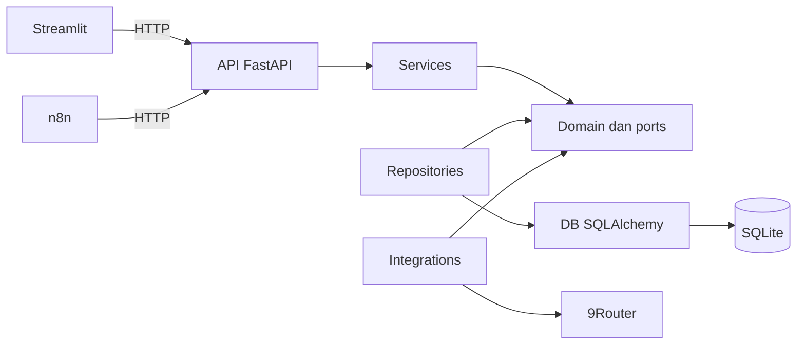

# Arsitektur MINORI

Backend adalah modular monolith: satu deployment dan satu database SQLite. Lapisan
memisahkan transport, use case, domain, serta adapter. Kapabilitas bisnis dapat
memiliki modul bernama sama di lapisan terkait ketika dibutuhkan, dengan kontrak
port yang jelas. Fondasi saat ini hanya menyediakan kesehatan layanan.

Composition root menyusun objek di `main.py` dan `api/dependencies.py`. Service
health menerima port `DatabaseProbe`, bukan Session SQLAlchemy. Adapter repository
melakukan `SELECT 1`; HTTP menerjemahkan hasil menjadi 200 atau 503. LLM tidak menjadi
syarat health dan tidak dibangun saat startup.

| Lapisan | Tanggung jawab |
| --- | --- |
| `api` | Router, dependency injection, status HTTP |
| `core` | Settings tervalidasi dan logging JSON |
| `domain` | Value objects dan kontrak port bebas framework |
| `services` | Use case yang bergantung ke domain |
| `repositories` | Adapter persistensi berdasarkan port domain |
| `schemas` | DTO Pydantic untuk transport |
| `db` | Engine, session, metadata dan lifecycle |
| `integrations` | Adapter 9Router dan layanan eksternal mendatang |

SQLAlchemy memakai engine sinkron, session per request, foreign keys aktif,
`busy_timeout` terbatas, dan WAL untuk file database. Route health sinkron diproses
oleh worker thread FastAPI. Semua perubahan skema melalui Alembic. Revisi
`foundation` hanya mencatat versi Alembic; tabel bisnis belum dibuat. WAL membantu
akses baca/tulis, tetapi SQLite tetap memiliki satu writer pada satu waktu. Gunakan
volume lokal untuk file SQLite dan jalankan satu worker backend dalam konfigurasi ini.

Streamlit dan n8n hanya berkomunikasi dengan API. Streamlit membaca settings
frontend sendiri. Compose mengirim kredensial 9Router hanya ke backend dan key
enkripsi n8n hanya ke n8n. Log aplikasi tidak mencetak bodies, secrets, atau settings.

9Router memakai Chat Completions melalui SDK OpenAI dengan base URL, key, model,
timeout dan retry yang eksplisit dari environment. Adapter menyediakan kontrak
teks dasar tanpa prompt bisnis. Tes menggunakan server HTTP lokal dengan key serta
model fiktif. Akses 9Router sebenarnya membutuhkan instance dan kredensial pengguna.

Acuan: [router modular FastAPI](https://fastapi.tiangolo.com/tutorial/bigger-applications/),
[SQLite SQLAlchemy](https://docs.sqlalchemy.org/en/20/dialects/sqlite.html),
[Alembic](https://alembic.sqlalchemy.org/en/latest/tutorial.html),
[SDK Python OpenAI](https://developers.openai.com/api/reference/python),
[API 9Router](https://github.com/decolua/9router), dan
[Docker n8n](https://docs.n8n.io/hosting/installation/docker/).
