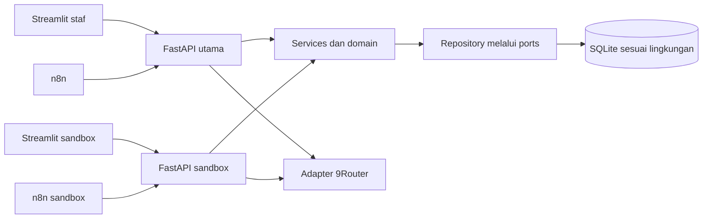

# Arsitektur

Backend adalah modular monolith dengan Clean Architecture.
Streamlit dan worker mengakses backend melalui HTTP, tanpa akses SQLite langsung.

| Direktori backend | Tanggung jawab |
| --- | --- |
| `domain/` | Entitas, aturan, dan port; standard library saja |
| `services/` | Use case dan transaksi; bergantung pada domain dan standard library |
| `repositories/` | Implementasi persistensi dengan SQLAlchemy |
| `integrations/` | Adapter 9Router, parser dokumen, dan isolasi sandbox |
| `schemas/` | Kontrak HTTP Pydantic |
| `api/` | Routing, autentikasi, RBAC, batas input, dan dependency injection |
| `core/` | Konfigurasi dan logging |
| `db/` | Engine, session, metadata, dan seed |
| `main.py` | Composition root dan lifecycle resource |

Session database dimiliki satu request. Repository melakukan flush; services menentukan
transaksi. Penempatan dan queue memakai `BEGIN IMMEDIATE` untuk pemeriksaan kuota/claim.
Panggilan provider berada di luar transaksi tulis.

Matching deterministik berada dalam domain. AI hanya menghasilkan bahan peninjauan;
output divalidasi sebelum digunakan dan tidak mempunyai alat untuk menulis database.

`frontend/app.py` menjalankan paket `frontend/minori_frontend/`.
`api_client.py` menangani HTTP, `pages/` berisi delapan halaman, dan `components/`
menyediakan komponen Streamlit bersama.

Frontend publik memerlukan login. Token sandbox disimpan server-side.
Backend sandbox memakai volume/network terpisah dan database sintetis per sesi;
credentials utama tidak diteruskan ke service publik.

Lihat [database](database.md), [matching](matching.md), [reminder](placements_reminders.md),
dan [sandbox](interactive_sandbox.md).
