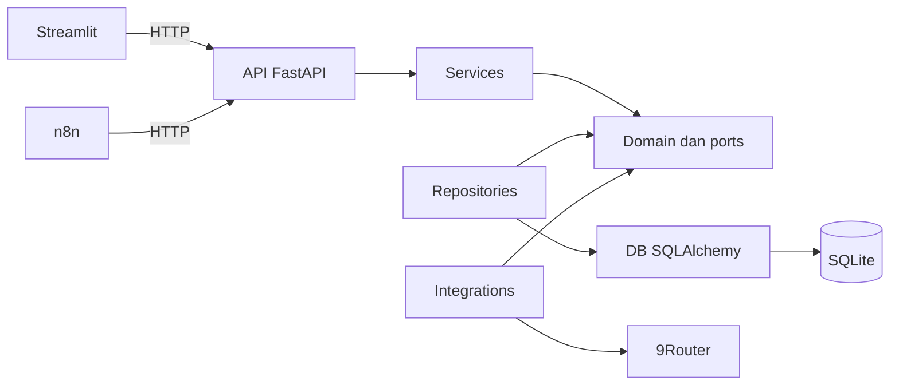

# Arsitektur MINORI

Backend adalah modular monolith: satu deployment dan satu database SQLite. Lapisan
memisahkan transport, use case, domain, serta adapter. Kapabilitas bisnis dapat
memiliki modul bernama sama di lapisan terkait ketika dibutuhkan, dengan kontrak
port yang jelas. Fondasi menyediakan kesehatan layanan dan akses database bisnis.
Model ORM ada di db/models, dataclass serta port repository di domain, dan schemas
Pydantic di schemas. Repository hanya mengembalikan snapshot domain yang terlepas
dari session; services tetap tidak mengimpor framework.

Composition root menyusun objek di `main.py` dan `api/dependencies.py`. Service
health menerima port `DatabaseProbe`, bukan Session SQLAlchemy. Adapter repository
melakukan `SELECT 1`; HTTP menerjemahkan hasil menjadi 200 atau 503. LLM tidak menjadi
syarat health dan tidak dibangun saat startup.

| Lapisan | Tanggung jawab |
| --- | --- |
| `api` | Router, dependency injection, status HTTP |
| `core` | Settings tervalidasi dan logging JSON |
| `domain` | Value objects dan kontrak port bebas framework |
| `services` | Use case yang bergantung ke domain |
| `repositories` | Adapter persistensi berdasarkan port domain |
| `schemas` | DTO Pydantic untuk transport |
| `db` | Engine, session, metadata dan lifecycle |
| `integrations` | Adapter 9Router dan layanan eksternal mendatang |

SQLAlchemy memakai engine sinkron, session per request, foreign keys aktif,
`busy_timeout` terbatas, dan WAL untuk file database. Route health sinkron diproses
oleh worker thread FastAPI. Semua perubahan skema melalui Alembic. Revisi
`foundation` mencatat versi awal dan `placement_database` menambahkan 13 tabel bisnis.
`explainable_matching` menambahkan riwayat evaluasi dan input preferensi opsional.
`placement_reminders` memperluas model yang sama untuk lifecycle penempatan dan queue.
Lihat [struktur database dan ERD](database.md). WAL membantu
akses baca/tulis, tetapi SQLite tetap memiliki satu writer pada satu waktu. Gunakan
volume lokal untuk file SQLite dan jalankan satu worker backend dalam konfigurasi ini.

Streamlit dan n8n hanya berkomunikasi dengan API. Streamlit membaca settings
frontend sendiri. Compose mengirim kredensial 9Router hanya ke backend dan key
enkripsi n8n hanya ke n8n. Log aplikasi tidak mencetak bodies, secrets, atau settings.

9Router memakai Chat Completions melalui SDK OpenAI dengan base URL, key, model,
timeout dan retry yang eksplisit dari environment. Adapter menyediakan kontrak
teks dasar tanpa prompt bisnis. Tes menggunakan server HTTP lokal dengan key serta
model fiktif. Akses 9Router sebenarnya membutuhkan instance dan kredensial pengguna.

Matching berada pada modul domain/eligibility.py, scoring.py, matching_engine.py,
dan matching.py untuk values/ports. Service matching hanya mengimpor domain dan
standard library; transaksi diterima sebagai factory context manager dari DI.
Adapter evaluation melakukan append/read tanpa commit, sementara service memakai
satu transaksi untuk batch dan penggantian aggregate beserta recompute. API hanya
memvalidasi transport, memanggil service, dan menerjemahkan error HTTP.
Evaluasi tersimpan terpisah dari Match staf. Ranking membaca data/waktu terkini;
GET tidak menulis history. Lihat [algoritma](matching.md) dan [API](api.md).

PlacementService menerima approval staf eksplisit serta memvalidasi kuota dan
transisi. ReminderService menghasilkan intent, mengelola lease/retry, dan memproses
dry-run. Service disusun melalui ReminderCoordinator domain, tanpa import service
lain atau framework. DI memberikan factory BEGIN IMMEDIATE untuk mutasi placement
dan queue. Conditional UPDATE bersama writer lock SQLite menegakkan claim eksklusif.
Network provider tidak berada dalam transaksi. Token internal berasal dari environment.
Lihat [placement/reminder](placements_reminders.md).

## Arsitektur Frontend Streamlit

Frontend diimplementasikan dengan **Python 3.12 + Streamlit** multi-page shell
(`st.navigation` dan `st.Page`), terorganisir dalam paket `minori_frontend`:
- `api_client.py`: HTTP connection pooling melalui HTTPX, penanganan timeout,
  server-side token handling, error mapping terstruktur (401, 403, 404, 409, 422, 503).
- `auth.py`: State RBAC session lokal memisahkan akses Staff (Admin/Tulis) dan
  Reviewer (Read-Only) serta verifikasi token terhadap endpoint `/auth/me`.
- `components/`: Komponen UI modular bergaya Japanese Minimalist Enterprise
  (kartu KPI Ashby, drawer profil kandidat, kartu bobot skor explainable matching,
  stepper visual pipeline, status pills, filter bars, alert dialogs).
- `pages/`: 8 halaman operasional independen yang hanya mengakses backend via HTTP,
  tanpa akses langsung ke SQLite atau model ORM backend (diverifikasi oleh uji batas arsitektur).
Detail operasional dan antarmuka didokumentasikan dalam [panduan frontend](frontend.md).

Acuan: [router modular FastAPI](https://fastapi.tiangolo.com/tutorial/bigger-applications/),
[SQLite SQLAlchemy](https://docs.sqlalchemy.org/en/20/dialects/sqlite.html),
[Alembic](https://alembic.sqlalchemy.org/en/latest/tutorial.html),
[SDK Python OpenAI](https://developers.openai.com/api/reference/python),
[API 9Router](https://github.com/decolua/9router), dan
[Docker n8n](https://docs.n8n.io/hosting/installation/docker/).
