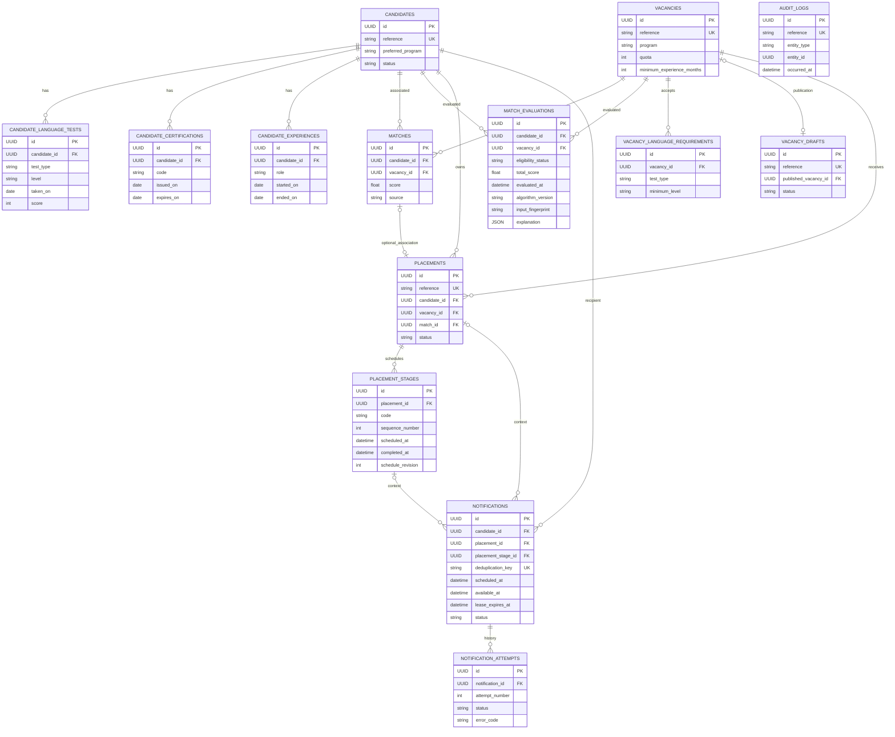

# Struktur database MINORI

Database aplikasi memiliki 14 tabel bisnis, dengan metadata SQLAlchemy pada
`backend/minori/db/models/`. Semua tabel menggunakan UUID sebagai primary key,
`created_at` dan `updated_at`. SQLite menyimpan UUID sebagai CHAR(32) dan timestamp
sebagai UTC; adapter mengembalikan datetime yang sadar zona waktu. Input timestamp
tanpa offset ditolak. Tanggal sertifikasi, tes, dan pengalaman memakai tipe date.

| Tabel | Isi utama dan identitas unik |
| --- | --- |
| candidates | reference, full_name, preferred_program, education_level, domicile_city, skills, preferred_prefectures, status; reference unik |
| candidate_language_tests | candidate_id, test_type, level, taken_on, score; unik kandidat + tes + tanggal |
| candidate_certifications | candidate_id, code, name, issuer, issued_on, expires_on; unik kandidat + kode + tanggal terbit |
| candidate_experiences | candidate_id, employer_name, sector, role, started_on, ended_on; unik kandidat + perusahaan + peran + tanggal mulai |
| vacancies | reference, title, employer_name, program, sector, prefecture, quota, minimum_experience_months, required_skills, required_certifications, preferred_skills, preferred_certifications, language_test_max_age_months, status, application_deadline; reference unik |
| vacancy_language_requirements | vacancy_id, test_type, minimum_level; satu persyaratan per jenis tes pada lowongan |
| vacancy_drafts | reference, source_channel, source_reference, proposed_data, status, published_vacancy_id; sumber dan reference unik, satu draft terbit per lowongan |
| matches | candidate_id, vacancy_id, status, source, score, reviewed_at; pasangan kandidat + lowongan unik |
| match_evaluations | candidate_id, vacancy_id, eligibility_status, total_score, evaluated_at, algorithm_version, input_fingerprint, explanation; unik pasangan + fingerprint + waktu + versi |
| placements | reference, candidate_id, vacancy_id, match_id, status, planned_departure_at, actual_departure_at; reference dan pasangan kandidat + lowongan unik |
| placement_stages | placement_id, code, step_type, sequence_number, status, scheduled_at, due_at, completed_at, location; kode dan urutan unik per placement |
| notifications | reference, deduplication_key, candidate_id, placement_id, placement_stage_id, template_code, scheduled_at, channel, status, sent_at; reference dan deduplication_key unik |
| notification_attempts | notification_id, attempt_number, status, attempted_at, finished_at, error_code, provider_reference; nomor percobaan unik per notification |
| audit_logs | reference, actor_reference, action, entity_type, entity_id, occurred_at, context; reference unik |

## ERD

Hubungan berikut merupakan foreign key fisik, termasuk hubungan opsional.
Foreign key gabungan menegakkan kesamaan pemilik dan pasangan pada relasi terkait.



Audit memakai referensi polimorfik logis `entity_type + entity_id`, tanpa foreign key
fisik. Identitas resource tetap tersimpan sebagai riwayat audit. Repository audit
dan notification attempt hanya menyediakan append/read; tidak ada update/delete.
Context audit dibatasi ke synthetic/fixture, kode alasan, status, timestamp
administratif, schedule_revision, dan nomor attempt. Ini batas antarmuka
repository, bukan mekanisme pencegah perubahan SQL langsung.

## Constraints dan data yang sengaja tidak disimpan

Foreign key Match ke kandidat/lowongan dan seluruh relasi inti memakai RESTRICT.
Kualifikasi anak kandidat dan persyaratan bahasa anak lowongan memakai CASCADE;
repository mengarsipkan kandidat/lowongan tanpa hard delete. Penggantian aggregate
secara eksplisit mengganti koleksi anak yang diberikan. Pemanggil wajib menggunakan
transaksi untuk memastikan penggantian seluruhnya berhasil atau rollback.

Placement yang menyertakan match harus memakai kandidat dan lowongan yang sama
dengan match tersebut. Notification yang menyertakan placement harus memakai
kandidat pemilik placement; langkah yang disertakan harus berada dalam placement
yang sama. Constraint ini berlaku juga untuk penulisan langsung ke SQLite.

Quota harus positif; pengalaman minimum dan score memiliki batas. Status berupa
enum dengan CHECK database. Urutan langkah dan nomor attempt harus positif serta
unik pada induknya. Validitas tanggal sertifikasi/pengalaman, pasangan tes-level,
rentang jadwal, timestamp completion/review/sent, dan rentang attempt diperiksa.
Pydantic menambahkan batas panjang, penolakan field tak dikenal, duplikasi anak,
angka non-finite, serta kesesuaian level dengan score JFT-Basic.

Medical check-up hanya memiliki kode, status, jadwal, dan lokasi administratif.
Diagnosis, hasil laboratorium, medical findings, dokumen identitas, nomor paspor,
kontak pribadi, message body, dan raw provider payload tidak disimpan.

## Bahasa dan persyaratan lowongan

JLPT disimpan sebagai jenis tes `jlpt` dengan level N5 sampai N1. JFT-Basic memakai
`jft_basic` dengan level canonical A1, A2.1, atau A2.2; A2.2 merupakan label A2
dalam referensi resmi. Kedua skala tidak dikonversi atau diurutkan secara silang.
[JLPT](https://www.jlpt.jp/e/about/levelsummary.html),
[JFT-Basic](https://www.jpf.go.jp/jft-basic/e/about/index.html).

Baris language requirement pada satu lowongan merupakan alternatif jenis tes yang
diterima pemberi kerja. Kebutuhan sertifikasi dan skill memakai kode yang sama dengan
kode pada kandidat. Nilai program titp, ssw, dan engineer merupakan kategori internal;
fixture persyaratan bukan penetapan kelayakan visa atau ketentuan hukum. Matching
mengevaluasi persyaratan pemberi kerja dan menyimpan explanation deterministik;
ranking tidak mengalokasikan placement. PlacementService memeriksa kuota terpakai
dalam transaksi ketika staf membuat placement dari match approved.

## Data access dan transaksi

Port di `domain/repositories.py` menerima dataclass domain dan mengembalikan snapshot
domain. Implementasi berada pada `repositories/`; ORM berada pada `db/models/`.
Input divalidasi Pydantic pada batas adapter. Tidak ada import SQLAlchemy/Pydantic
dari domain maupun service. `api/dependencies.get_repositories` memakai dependency
session yang sudah tersedia; semua adapter dalam satu request memakai session yang sama.

Repository melakukan flush tanpa commit. Pemanggil menentukan batas transaksi:

```python
from minori.repositories.provider import provide_repositories
from minori.schemas.candidate import CandidateCreate

with database.session_factory.begin() as session:
    repositories = provide_repositories(session)
    record = repositories.candidate.create(CandidateCreate(**payload).to_domain())
```

Get mengembalikan None bila tidak ditemukan. Update/archive yang tidak menemukan
record melempar RecordNotFoundError. Identitas reference dan pemilik history tidak
dapat diganti oleh replace. List mendukung pagination 1..100 dengan urutan stabil.
Matching menyediakan endpoint evaluasi, history, ranking, explanation, dan
penggantian profil dengan recompute. Lihat [kontrak HTTP](api.md).

## Migrasi dan seed

Urutan revisi adalah `foundation -> placement_database -> explainable_matching -> placement_reminders`.
Revisi bisnis berada di business_tables.py dan matching berada di matching_evaluations.py.
Upgrade matching menambahkan satu tabel dan empat kolom opsional/default tanpa
rebuild tabel kandidat, lowongan, atau matches. Upgrade bisnis menambah tabel serta
indexes; migration foundation dipertahankan. Downgrade menolak database yang masih
memiliki baris bisnis sebelum menghapus tabel apa pun. Downgrade SQL offline ditolak
karena pemeriksaan data memerlukan koneksi. Database kosong dapat di-rollback dan
di-upgrade lagi untuk pengujian.

Downgrade matching menolak history atau preferensi yang sudah dikonfigurasi.
Jika seluruh tambahan kosong, target eksplisit placement_database dapat dipakai
tanpa menghapus data lama. Dengan data bisnis lama, target yang lebih rendah atau
relatif ditolak sebelum perubahan skema untuk menghindari DDL parsial SQLite.
Revisi foundation dan placement_database tidak diubah.

## Perluasan placement dan reminder

placement_reminders.py tidak membuat model/tabel duplikat. PlacementStage mendapat
schedule_revision positif. Notification mendapat snapshot jadwal dan field queue:
managed, dry_run, available_at, event_at, schedule_revision, schedule_context,
attempt_count, max_attempts, claimed_at, lease_expires_at, claim_token_hash,
processed_at, last_error_code. Counter nonnegatif, claim processing wajib memiliki
lease valid, dan managed reminder wajib memiliki activity/event/availability.
Index managed/status/available_at mendukung pengambilan antrean.

NotificationAttempt menambah claim_token_hash unik nullable. finished_at nullable
hanya untuk processing; terminal attempt wajib selesai. Claim membuka attempt dan
callback/recovery memfinalisasinya melalui queue adapter. Port attempt umum tetap
append/read; retry berikutnya tidak menimpa attempt terminal. Status simulated dan
abandoned membedakan simulasi serta kehilangan lease dari keberhasilan nyata.
Audit entity_type kini menerima match dan placement_stage.

Data legacy notification default managed=false sehingga tidak dikirim worker;
dry_run=true dan counter nol tidak mengubah status/sent_at legacy. Seluruh UUID,
foreign keys composite, attempts, placement, dan keputusan matching lama tetap
dipertahankan. Medical hanya metadata administratif.

Batch migration SQLite memakai transaksi DDL eksplisit, foreign key enforcement
dimatikan hanya pada koneksi migrasi, lalu foreign_key_check diperiksa sebelum
commit. Enforcement kembali aktif sesudahnya. Snapshot schema aktivitas membekukan
seluruh constraint dan memberi nama unik terpisah untuk code/sequence/owner; nama
constraint lama yang bertabrakan tidak boleh hilang akibat reflection batch.

Downgrade menolak data reminder/claim/decision baru sebelum perubahan apa pun.
Database kosong dapat round-trip; database legacy tanpa data baru dapat kembali
ke explainable_matching. Guard juga melindungi downgrade lebih dalam ketika ada
matching history. Semua migration sebelumnya dipertahankan. Lihat
[aturan placement/reminder](placements_reminders.md).

## Penyimpanan evaluasi mesin

MatchEvaluation memakai foreign key RESTRICT ke kandidat dan lowongan, index
pasangan/waktu dan lowongan/eligibility, CHECK enum dan score 0..1. Total score wajib
ada hanya bagi ELIGIBLE. Dua hasil lain menyimpan null total, dengan komponen
diagnostik tetap pada explanation JSON. UUID dan timestamps mengikuti model lama.
Riwayat append/read melalui repository; proteksi terhadap SQL langsung tidak ditambahkan.

Tidak ada FK ke Match karena evaluasi dapat terjadi sebelum asosiasi staf dibuat.
API menggabungkan keputusan staf lewat pasangan kandidat/lowongan unik. Field
matches.status/source/score/reviewed_at tidak dimodifikasi oleh matching.
input_fingerprint dan algorithm_version mengidentifikasi input/kebijakan evaluasi.

preferred_prefectures, preferred_skills, dan preferred_certifications memiliki
default array kosong sehingga data lama tetap terbaca. language_test_max_age_months
nullable dan harus positif bila diisi. Preferensi opsional dipakai hanya untuk
scoring; umur tes opsional digunakan untuk evidence bahasa. Detail rumus, freshness,
dan batas transaksi tersedia di [algoritma matching](matching.md).

```sh
python -m alembic upgrade head
python scripts/seed_database.py
python scripts/seed_database.py
python scripts/check_database.py
```

Seed memakai reference, pasangan kandidat/lowongan, placement+code,
deduplication_key, dan notification+attempt_number sebagai natural key. Insert
dilakukan dalam satu transaksi; kegagalan menyebabkan rollback seluruh insert.
Baris yang sudah ada tidak ditimpa, termasuk hasil penyuntingan dan ID anak.
Jalankan seed secara berurutan; tidak ada jaminan kedua seeder konkuren berhasil
tanpa konflik unique. Tidak ada seed otomatis saat startup. CLI seed hanya menerima
lingkungan development/test.

```sh
docker compose exec -T backend python scripts/seed_database.py
docker compose exec -T backend python scripts/seed_database.py
docker compose exec -T backend python scripts/check_database.py
```

Tiga file fixture pada data/dummy dimasukkan ke image backend bersama entry point
seed/check. Database dan konfigurasi sensitif tetap dikecualikan dari build context.
Delapan kandidat mencakup sektor pertanian, dapur, perawatan, pengelasan, engineering,
hotel, peserta baru, dan kandidat nonaktif. Lima lowongan memiliki variasi program,
kompetensi, pengalaman minimum, kuota, dan alternatif bahasa. Tanggal fixture tetap;
status historis merupakan ilustrasi data sintetis, tanpa pengiriman sebenarnya.
