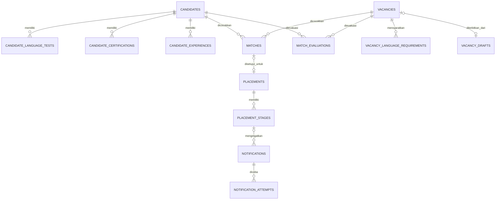

# Database

ORM berada di `backend/minori/db/models/`. Skema dikelola Alembic.
UUID digunakan untuk relasi internal; timestamp disimpan dalam UTC.
Input waktu API harus menyertakan zona waktu.

## Tabel

| Tabel | Penggunaan |
| --- | --- |
| `candidates` | Profil, preferensi, kesiapan, dan kontak opsional |
| `candidate_language_tests` | Bukti JLPT/JFT-Basic |
| `candidate_certifications` | Sertifikasi dan masa berlaku |
| `candidate_experiences` | Riwayat pengalaman |
| `vacancies` | Lowongan, kuota, dan persyaratan |
| `vacancy_language_requirements` | Alternatif tes bahasa |
| `vacancy_drafts` | Draf, metadata review AI, dan publikasi |
| `matches` | Keputusan staf |
| `match_evaluations` | Hasil algoritma, fingerprint, dan penjelasan |
| `placements` | Penempatan |
| `placement_stages` | Aktivitas, jadwal, lokasi, dan revisi |
| `notifications` | Queue, lease, retry, dan snapshot email |
| `notification_attempts` | Riwayat percobaan |
| `audit_logs` | Tindakan administratif |



Foreign key/constraint menegakkan pemilik aktivitas, pasangan matching,
referensi unik, deduplikasi, dan nomor percobaan.
Pengarsipan/pembatalan mempertahankan riwayat. Perubahan profil dan evaluasi ulang
matching berlangsung dalam satu transaksi.

Kontak demo menggunakan `.invalid`. Isi email yang disetujui disimpan sebagai
snapshot; raw respons provider tidak disimpan. Medical hanya menyimpan jadwal
dan lokasi administratif, tanpa diagnosis/hasil laboratorium.

## Migrasi dan seed

Revisi: `foundation → placement_database → explainable_matching →
placement_reminders → ai_message_snapshots`.
Gunakan `alembic upgrade head` dan `alembic check`.
Downgrade yang berisiko menghapus data bisnis ditolak.

Profil demo memakai `professional_demo_data/professional-demo.db`, terpisah dari
`backend_data` dan `n8n_data`.
Seed profesional berisi 24 kandidat, 10 lowongan, 8 penempatan, dan 3 draf sintetis.
Matching dihitung engine; keputusan dan penempatan dibuat melalui operasi bisnis.

Sandbox memakai volume `sandbox_data` dan salinan database per login.
Reset sesi tidak menyentuh database staf atau sesi pengunjung lain.

## Reset demo

Perintah pertama hanya preview; perintah kedua memerlukan konfirmasi dan membuat backup:

```powershell
docker compose -f compose.yaml -f compose.demo.yaml exec -T backend python scripts/reset_demo.py
docker compose -f compose.yaml -f compose.demo.yaml exec -T backend python scripts/reset_demo.py --confirm RESET-MINORI-DEMO
```

Reset hanya menerima environment demo, nama database khusus, migrasi terkini,
serta identitas/relasi dataset yang terverifikasi. Data tambahan/non-demo atau
schema asing menyebabkan penolakan. Jangan melewati pemeriksaan atau menghapus volume.

Untuk demo publik gunakan **Penggunaan & reset sesi**.
Budget tetap berlaku dan salinan sebelum reset disimpan privat sampai sesi dibersihkan.
Lihat [sandbox](interactive_sandbox.md).
