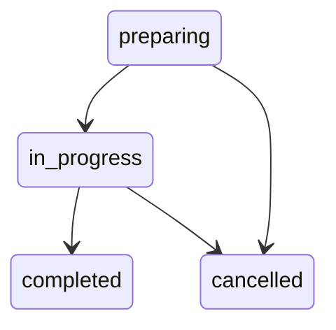

# Placement Management dan Reminder Backend

Fitur ini menggunakan model Placement, PlacementStage, Notification, dan
NotificationAttempt yang sudah tersedia. Domain memuat aturan murni Python;
service mengorkestrasi transaksi melalui port; repository menangani SQLAlchemy.
Tidak ada scheduler background, workflow n8n, SMTP, atau pengiriman WhatsApp.

## Persetujuan manusia dan kapasitas

POST /matching/decisions merupakan tindakan staf yang eksplisit, dengan actor_reference
dan token. Eligibility mesin tidak diubah. APPROVED dapat dicatat untuk ELIGIBLE
atau NEEDS_REVIEW; NOT_ELIGIBLE tidak dapat disetujui. Pembuatan placement tetap
memerlukan ELIGIBLE terkini, sehingga approval NEEDS_REVIEW tidak melewati syarat
kesiapan. REJECTED tidak dapat mengganti keputusan pasangan yang masih memiliki
placement non-cancelled; placement harus dibatalkan terlebih dahulu.

POST /placements menerima match_id yang telah approved. Service memeriksa pasangan
kandidat/lowongan, program, status, deadline dan persyaratan terkini dengan Matching
Engine yang sama, satu placement aktif per kandidat, serta kapasitas lowongan.
Preparing, in_progress, dan completed mengonsumsi kuota. Cancelled membebaskan kuota.
Placement yang selesai tetap mengonsumsi kuota karena kursinya sudah digunakan.
Tidak ada alokasi kandidat otomatis dari ranking.

Transaksi BEGIN IMMEDIATE mengambil hak writer SQLite sebelum membaca kapasitas.
Dua request yang memperebutkan kursi terakhir diserialisasi. Constraint pasangan
kandidat/lowongan tetap berlaku. Pengulangan create dengan reference, match,
planned departure, dan placement preparing yang sama mengembalikan record yang ada.
Pasangan cancelled tidak dibuat ulang menjadi record duplikat.

## Status dan aktivitas administratif

Transisi placement:



Completed dan cancelled terminal. Untuk memulai placement diperlukan kandidat aktif
dan match approved. Penyelesaian memerlukan semua aktivitas sudah completed/cancelled.
DELETE placement adalah pembatalan logis, dengan pembatalan aktivitas outstanding
dan reminder; tidak menghapus history atau audit. PATCH mengubah status dan waktu
keberangkatan administratif. Actual departure masa depan ditolak.

Aktivitas memakai PlacementStage: interview, medical_check, documents, orientation,
atau departure. API menggunakan istilah activities. Pending dapat menjadi scheduled
atau cancelled; scheduled dapat menjadi in_progress/completed/cancelled; in_progress
dapat menjadi completed/cancelled. Status terminal tidak dapat dibuka kembali.
PATCH pending dengan scheduled_at otomatis menjadi scheduled. Aktivitas tidak dapat
dimulai sebelum jadwal atau diselesaikan sebelum jadwal/di masa depan.

Jadwal baru/perubahan jadwal harus di masa depan dan dilakukan sebelum aktivitas
in_progress. due_at adalah deadline administratif yang harus >= scheduled_at.
Documents dapat memakai scheduled_at sebagai awal pengumpulan dan due_at sebagai
deadline. Hanya interview dan medical_check menghasilkan reminder kalender.
Perubahan scheduled_at, due_at, location, atau pembatalan meningkatkan schedule_revision.
Medical check-up menyimpan jadwal dan lokasi administratif; tidak ada diagnosis,
hasil pemeriksaan, atau temuan medis.

Panduan diagnosis insiden dan uji n8n/Mailpit terisolasi tersedia di
[panduan AI/n8n](ai_operations.md).

## Perhitungan reminder

BUSINESS_TIMEZONE default Asia/Jakarta; REMINDER_DELIVERY_TIME default 09:00.
Timestamp masuk harus memiliki offset dan disimpan sebagai UTC. Perhitungan:

- Interview: tanggal lokal acara dikurangi 3 hari kalender, pukul 09:00 lokal.
- Medical: tanggal lokal acara dikurangi 1 hari kalender, pukul 09:00 lokal.
- Hari libur/akhir pekan tetap dihitung; bukan pengurangan 72/24 jam dari jam acara.
- Waktu lokal yang ambigu/tidak tersedia karena DST ditolak agar tidak memilih offset diam-diam.

Contoh interview 16 Oktober 2026 14:00 WIB menghasilkan reminder 13 Oktober
2026 09:00 WIB, disimpan 2026-10-13T02:00:00Z. Medical pada jadwal yang sama
menghasilkan 15 Oktober 09:00 WIB, disimpan 2026-10-15T02:00:00Z.

scheduled_at notification menyimpan waktu kalender yang direncanakan. available_at
menyimpan waktu antrean dapat diproses. Jika dibuat terlambat tetapi acara belum
dimulai, available_at=now untuk catch-up. Jika acara sudah dimulai, status missed;
tidak mengirim pengingat acara yang sudah lewat. Perbandingan event_at <= now
termasuk tepat pada waktu mulai.

NOTIFICATION_DRY_RUN default true. Setiap notification menyimpan mode saat dibuat;
perubahan konfigurasi tidak mengubah mode record lama. Template Bahasa Indonesia
meliputi interview_h3, medical_h1, schedule_changed, dan schedule_cancelled. Body
dirender saat claim dari snapshot jadwal; body/kontak pribadi tidak disimpan atau
dicetak ke log. Kanal saat ini internal; belum ada adapter pengiriman eksternal.

## Idempotensi dan perubahan jadwal

Key awal: reminder:{activity_id}:r{revision}. Generator berulang untuk revision sama
tidak menambah reminder. Unsent reminder diperbarui dengan ID dan key yang sama
ketika jadwal berubah. Attempt terdahulu tetap tersimpan; retry budget untuk jadwal
baru ditambahkan ke counter kumulatif, tanpa memakai ulang nomor attempt.

Reminder yang sudah sent/simulated tetap menjadi history. Jadwal baru menghasilkan
satu pengingat baru untuk revision baru dan satu notice perubahan dengan key
notice:{activity_id}:r{revision}:changed. Pengulangan perubahan yang identik tidak
menambah revision atau reminder. Maksimal satu pengingat utama pending per aktivitas;
history terminal dan notice merupakan record berbeda dengan tanggung jawab jelas.

Pembatalan menghentikan reminder unsent. Bila sebelumnya sudah sent/simulated,
satu notice pembatalan dibuat. Notice siap diproses segera dan memiliki jendela
hingga max(waktu acara, now+24 jam). Notice tidak bergantung pada aktivitas masih
scheduled, karena tujuan notice adalah memberitahukan pembatalan/perubahan.

Perubahan jadwal/pembatalan saat processing menutup attempt sebagai abandoned,
mencabut lease, dan membuat callback lama invalid. Worker eksternal yang sudah
memulai pengiriman mungkin tetap menyelesaikannya di provider; pencabutan token
tidak menarik kembali pesan yang sudah dikirim.

## Claim, retry, dan recovery

PENDING -> PROCESSING dilakukan dengan BEGIN IMMEDIATE dan conditional UPDATE.
Hanya managed=true, due, event belum lewat, retry budget tersedia, dan aktivitas
aktif yang dapat diklaim. Data notification fixture lama default managed=false
sehingga tidak ikut antrean pengiriman. Candidate inactive dan placement/aktivitas
yang sudah tidak aktif membatalkan reminder pada maintenance berikutnya.

Claim menghasilkan token acak, lease_expires_at, dan satu NotificationAttempt
processing dengan finished_at null. Hanya SHA-256 token disimpan. Token asli muncul
sekali dalam respons claim yang terlindungi; tidak muncul pada GET/history/log.
Satu notification hanya dapat dimiliki satu claim aktif. Default lease 120 detik.

Callback harus menyertakan bearer token internal dan claim_token yang masih valid.
Outcome simulated hanya diterima untuk dry_run=true; sent hanya untuk dry_run=false
dengan provider_reference. Simulated tidak boleh memakai provider_reference dan
sent_at tetap null. Pengulangan callback identik diterima selama token attempt
terakhir masih sama; callback berbeda, token lama, expired, atau cancelled ditolak 409.

Failure memakai enum error code aman, tanpa pesan exception/provider bebas.
Backoff = min(retry_max_seconds, retry_base_seconds × 2^(attempt_number−1)).
Default 3 percobaan total, backoff awal 60 detik, maksimum 3600 detik. Nomor attempt
kumulatif tetap unik setelah perubahan jadwal; backoff tetap dibatasi maksimum.
Jika budget habis, status failed. Jika retry berikutnya sudah mencapai waktu acara,
status missed. Tidak ada retry tak terbatas.

Lease yang habis menutup attempt sebagai abandoned dengan LEASE_EXPIRED, lalu
menjadwalkan retry sesuai budget/backoff. Claim, generate, recover, dan pengambilan
due menjalankan maintenance. Tidak ada worker permanen saat startup; caller harus
memanggil endpoint atau script secara berkala. Tidak ada network call di dalam
transaksi writer; pengiriman eksternal kelak dilakukan di antara claim dan callback.

Queue ini menjamin eksklusivitas claim database. Retry dapat mengulang pengiriman
eksternal: worker dapat mengirim pesan lalu terhenti sebelum callback, sehingga
provider mungkin menerima duplikasi. Retry terbatas juga tidak menjamin pesan
akhirnya terkirim. Provider idempotency key/reconciliation
diperlukan untuk memperkecil risiko itu. Sistem tidak menjamin email exactly once.
Status sent adalah acknowledgement worker, bukan verifikasi independen dari provider.

## Auth, audit, dan konfigurasi

Semua mutasi staf serta endpoint /internal/reminders menggunakan
Authorization: Bearer <INTERNAL_API_TOKEN>. Token berasal dari environment/.env,
minimal 32 karakter; bootstrap membuat token acak tanpa mencetaknya. Token kosong
menghasilkan 503 (fail closed); token hilang/salah menghasilkan 401. Jangan menaruh
token dalam query string, command history, workflow tersimpan, atau commit.

actor_reference wajib pada mutasi staf. Ini identitas operasional yang dinyatakan
pemanggil, bukan login akun/role pengguna. Auth saat ini memakai shared token,
sesuai cakupan backend lokal. Approval harus dipanggil secara eksplisit oleh staf;
matching/generator/worker tidak membuat approval atau placement otomatis.

Audit memuat tindakan decision, create/update/cancel placement, aktivitas, reminder,
claim, retry, recovery, dan completion. Context dibatasi ke kode/status/timestamp/
revision/nomor attempt. Perubahan penting beserta audit terjadi dalam transaksi
yang sama; kegagalan audit menggagalkan mutasi. GET tidak mencetak credential atau
payload pribadi. Attempt dibuka pada claim dan difinalisasi sekali oleh queue;
history attempt terminal tidak diubah oleh retry berikutnya.

## Menjalankan tanpa n8n

```sh
python scripts/bootstrap.py
python -m alembic upgrade head
python scripts/verify_reminders.py
python scripts/reminder_worker.py --generate --simulate
```

verify_reminders.py membuat database sementara yang terisolasi, menjalankan
Uvicorn nyata pada port lokal sementara, dan membuktikan approval -> placement ->
interview -> H-3 -> claim -> simulated -> history -> reschedule -> medical H-1
melalui HTTP. Token sementara tidak dicetak. Proses berhenti dan database sementara
dibersihkan setelah hasil/integritas diverifikasi; database proyek tidak dimodifikasi.
Sebelum pukul 09:00 demo memakai catch-up H-3 agar dapat dijalankan kapan saja.

reminder_worker.py memanggil backend yang sudah berjalan; membaca token dari settings,
memanggil generation/recovery/due, lalu opsi --simulate memproses maksimal --limit
reminder melalui API. Tidak ada email/WhatsApp yang dikirim. Gunakan --base-url untuk
alamat backend yang berbeda. Semua pengujian memakai data fiktif.

```sh
docker compose run --rm --no-deps backend python scripts/verify_reminders.py
docker compose exec -T backend python scripts/reminder_worker.py --base-url http://127.0.0.1:8000 --generate --simulate
```

Kedua perintah merupakan verifikasi lokal, bukan deployment. Kontrak endpoint tersedia melalui Swagger UI FastAPI (`http://localhost:8000/docs`),
migrasi dijelaskan dalam [database](database.md), dan perintah di atas dapat
digunakan untuk mengulang verifikasi.
